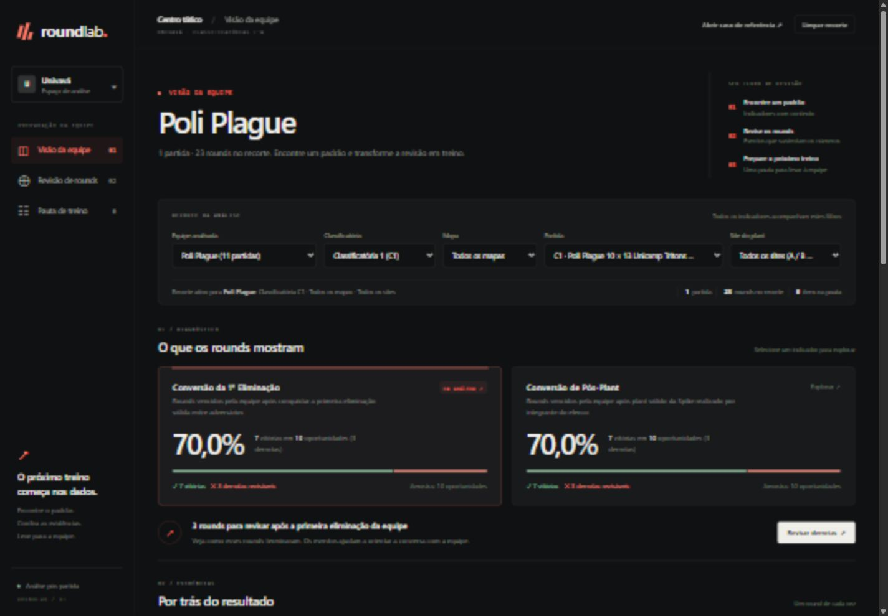

# RoundLab

Ferramenta pós-partida para ajudar treinadores e equipes universitárias de VALORANT a transformar os dados oficiais do **Univavá (Classificatórias 1 a 4)** em análises coletivas rastreáveis e uma pauta de revisão e treino.



A interface organiza a revisão em diagnóstico, evidências e pauta de treino. O Centro tático usa grafite e coral, filtros recolhíveis no celular e transições que respeitam a preferência por movimento reduzido. [Detalhes e verificação da reformulação](docs/centro-tatico.md).

### Ferramentas para a revisão

- Busca por jogador envolvido nos eventos, equipe, mapa ou número exato do round; filtra apenas a lista de evidências, sem alterar os indicadores.
- Pauta salva neste navegador e restaurada a partir das referências da base atual. Ela não é sincronizada com outros dispositivos; use copiar ou baixar `.txt` para compartilhar.
- Inclusão e remoção identificam a perspectiva da equipe. A limpeza da pauta pode ser desfeita durante a sessão.
- “Como ler os dados” explica as fórmulas, exclusões e limites de interpretação.
- Carregamento com limite de 15 segundos e tentativa manual de recuperação quando os dados não estão disponíveis.

[Comportamento e validação dessas ferramentas](docs/ferramentas-de-revisao.md).

---

## Escopo do Protótipo (MVP)

O fluxo central segue quatro etapas:
**Selecionar equipe → Encontrar padrão nos indicadores → Inspecionar evidências por round → Exportar/Imprimir pauta de treino.**

1. **Conversão da 1ª Eliminação em Vitória:** proporção de rounds vencidos pela equipe após conquistar a primeira eliminação válida entre adversários.
2. **Conversão de Pós-Plant em Vitória:** proporção de rounds vencidos pela equipe após realizar um plant válido da Spike (segmentável por Bomb Site `A`, `B` ou `C`).
3. **Inspeção de Evidências por Round:** linha do tempo em milissegundos (eliminações deduplicadas, plant e desarme), lado atacante/defensor derivado de `winningTeamRole` e elencos.
4. **Pauta de Revisão e Treino Copiável e Imprimível:** separa explicitamente **observações sustentadas pelos dados** de **hipóteses de exercício para avaliação do treinador**, com alternativa selecionável caso a área de transferência esteja indisponível e folha de impressão dedicada (`@media print`).

---

## Comandos de Execução

Requer **Node.js 24+** (sem dependências externas de produção):

```bash
# 1. Baixar/validar os 199 JSONs oficiais (C1 a C4), gerar manifesto, relatório e dados derivados
npm run import

# 2. Executar a suíte completa de testes automatizados (normalização, métricas e pauta)
npm test

# 3. Iniciar o servidor local seguro em http://127.0.0.1:4173
npm run serve

# 4. Empacotar versão autônoma de entrega em dist/ (independente do Drive e sem dados brutos)
npm run package
```

Para executar diretamente a cópia empacotada em `dist/`:

```bash
cd dist
node scripts/serve.mjs
```

---

## Metodologia, Fórmulas e Regras de Exclusão

### 1. Conversão da 1ª Eliminação (`firstKillConversion`)

Em cada round do recorte selecionado:
- Reúnem-se todos os eventos de `roundResults[].playerStats[].kills`, removendo duplicatas idênticas pela chave `(killerId, victimId, timeMs)` e ordenando por `timeMs` crescente.
- Consideram-se elegíveis apenas eliminações com `timeMs >= 0` entre jogadores de equipes adversárias com identidades (`puuid`) e equipes (`Red`/`Blue`) resolvidas. Eliminações de fogo amigo (*friendly fire*) ou com autor/vítima desconhecidos são ignoradas.
- A **primeira eliminação** é o evento elegível de menor `timeMs`.
- **Exclusão por ambiguidade:** se duas equipes adversárias registrarem eliminações no exato mesmo menor `timeMs` do round, o round é classificado como ambíguo e registrado em `excluded` (fora do denominador).

$$\text{Taxa de Conversão da 1ª Eliminação} = \frac{\text{Rounds vencidos pela equipe após conquistar a 1ª eliminação}}{\text{Rounds em que a equipe conquistou a 1ª eliminação}}$$

### 2. Conversão de Pós-Plant (`postPlantConversion`)

Em cada round com evento de plant (`bombPlanter`, `plantRoundTime` ou `plantSite`):
- Resolve-se a equipe de `bombPlanter` pelo elenco ativo da partida (`puuid`).
- O resultado do round vem exclusivamente do campo oficial `winningTeam` (`Red` ou `Blue`), sem inferência manual sobre desarme ou mortes.
- **Exclusões documentadas:** se houver registro de plant sem identidade/equipe resolvida, com `plantRoundTime <= 0` ou com `defuseRoundTime < plantRoundTime`, o round é registrado em `excluded` e jamais contabilizado como derrota.

$$\text{Taxa de Conversão de Pós-Plant} = \frac{\text{Rounds vencidos pela equipe após plant válido}}{\text{Rounds com plant válido da equipe (no site filtrado, quando aplicável)}}$$

### 3. Regras de Apresentação Responsável

- **Numeração humana:** o round exibido ao usuário é sempre `roundNum + 1` (baseado em 1).
- **Amostra pequena:** qualquer indicador com menos de 10 oportunidades (`opportunities < 10`) exibe aviso explícito de amostra pequena (`smallSample: true`).
- **Denominador zero:** quando `opportunities === 0`, a taxa é `null` e a interface exibe **`Sem dados`**, nunca `0%`.
- **Acessibilidade visual:** vitória e derrota são sempre comunicadas com rótulo textual e símbolo (`✓ VITÓRIA` / `✕ DERROTA`), sem depender apenas de cor.

---

## Cobertura Oficial e Casos Conferidos Manualmente

Foram baixados e auditados **199 arquivos JSON oficiais** das pastas **Univavá / Classificatórias 1 a 4** (`C1`: 55, `C2`: 39, `C3`: 43, `C4`: 62), totalizando **199 partidas válidas** e **61 identificadores de equipes** (`data/quality-report.json`).

### Caso 1: Partida de Referência da Classificatória 1 (`Poli Plague 10 × 13 Unicamp Tritons Red`)
- **Arquivo:** `UNIVAVA_C1_002_27-06-26_poli_plague_10_x_13_unicamp_tritons_red_haven.json`
- **Identidade:** `matchId: fc187928-9b72-42b3-aaaf-8ca6689a3937` · Mapa `Haven` (`/Game/Maps/Triad/Triad`) · 23 rounds.
- **Resolução de lados:** `Red` (`roundsWon: 10`) = **Poli Plague**; `Blue` (`roundsWon: 13`) = **Unicamp Tritons Red** (confirmado pelo placar e cruzamento de `puuid` nas demais partidas do torneio).
- **Conversão da 1ª Eliminação (`Poli Plague`):** **`7/10` (`70,0%`)** — vitórias nos rounds `1, 8, 9, 12, 13, 14, 21` e derrotas nos rounds **`16, 20 e 22`**:
  - *Caso positivo conferido no bruto (Round 1 / `roundNum: 0`):* `timeSinceRoundStartMillis: 5398`, `killer` `Vks#bru` (`Red`) sobre `victim` `drs1 rei de itu#dela` (`Blue`), `winningTeam: "Red"`.
  - *Caso negativo conferido no bruto (Round 16 / `roundNum: 15`):* `timeSinceRoundStartMillis: 23180`, `killer` `Vks#bru` (`Red`) sobre `victim` `makola#deft` (`Blue`), `winningTeam: "Blue"`.
- **Conversão de Pós-Plant (`Poli Plague`):** **`7/10` (`70,0%`)** no geral (`5/8` no Site C e `2/2` no Site A) — vitórias nos rounds `1, 2, 5, 7, 8, 9, 12` e derrotas nos rounds **`3, 4 e 10`**:
  - *Caso positivo conferido no bruto (Round 1 / `roundNum: 0`):* `bombPlanter` `littlecyber#vrum` (`Red`), `plantRoundTime: 37001`, `plantSite: "C"`, `bombDefuser: null` (`defuseRoundTime: 0`), `winningTeam: "Red"`.
  - *Caso negativo conferido no bruto (Round 3 / `roundNum: 2`):* `bombPlanter` `Lukako#lucas` (`Red`), `plantRoundTime: 38127`, `plantSite: "C"`, `bombDefuser` `BRaim#nala` (`Blue`) em `defuseRoundTime: 55418`, `winningTeam: "Blue"` (`roundResultCode: "Defuse"`).

### Caso 2: Partida com Prorrogação de 36 Rounds na Classificatória 4
- **Arquivo:** `UNIVAVA_C4_002_12-09-26_pucgo_sistematica_academy_17_x_19_fatec_pg_sunset.json`
- **Identidade:** `matchId: 560367e5-24b2-4a9e-9be0-c711ca258398` · Mapa `Sunset` · **36 rounds** (`PUCGO Sistematica Academy` 17 × 19 `Fatec PG`).

---

## Limitações Reais do Conjunto de Dados e do Protótipo

1. **Ausência de trajetórias contínuas:** os arquivos JSON oficiais fornecem posições apenas no instante de eventos discretos (eliminações, plant e desarme), não permitindo replay contínuo de movimentação.
2. **Ressurreições e não-causalidade:** ressurreições (ex.: Sage/Clove) não são explicitadas como eventos dedicados de reversão numérica na estrutura inspecionada; portanto, a métrica de 1ª eliminação descreve uma taxa observada e não deve ser interpretada como relação causal direta.
3. **Variações nominais de equipes entre classificatórias:** todas as 199 partidas das Classificatórias 1 a 4 têm placar distinto do vencedor, permitindo resolver o lado `Red`/`Blue` contra o nome declarado no arquivo (`ambiguousTeams: 0`). Contudo, alguns elencos (`puuid`) competiram sob variações de nome entre etapas (ex.: `Unicamp Tritons Red` na C1 e `Unicamp Tritons Black` nas C2–C4 com 4 jogadores em comum; `CAAP Momentum` e `CAAP Malditos`). Por rigor metodológico, o sistema mantém os nomes oficiais de cada arquivo sem fundir equipes por suposição.

---

## Documentação Adicional

- [Especificação do MVP](docs/especificacao.md)
- [Plano de Implementação](docs/plano.md)
- [Roteiro do Pitch (até 5 minutos)](docs/roteiro-pitch.md)
- [Guia de Contribuição](CONTRIBUTING.md)

## Referência e Licença

O [UNIVLR](https://univlr.onrender.com/#/home) foi consultado apenas como referência conceitual de produto; nenhum código, identidade visual ou dado desse site foi incorporado. Projeto independente sob a [licença MIT](LICENSE).
